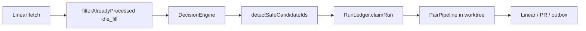

# Architecture

> This document is a structural map for agents onboarding to this repository quickly.
> For a human-oriented overview, see [README.md](README.md).
> Run state, lease and recovery invariants: [docs/DURABLE_AUTONOMY.md](docs/DURABLE_AUTONOMY.md).

## System overview

OpenSwarm is an autonomous orchestrator that picks up work from Linear (or the local issue store) and runs worktree-isolated workers. There are two sources of truth.

- **Intent**: Linear / local tracker (state, discussion, Done/Canceled).
- **Execution**: `~/.openswarm/automation.db` (`RunLedger`) — claim, lease, attempt, fileScope, outbox.

The heartbeat (`AutonomousRunner`) fetches issues, `filterAlreadyProcessed` opens parks and backoffs, `DecisionEngine` picks the runnable cards, `detectSafeCandidateIds` + `RunLedger.claimRun` fill the slots, and then `PairPipeline` runs Worker→Reviewer→Tester→Documenter.

## Directory tree (main parts)

```
src/
  automation/     — heartbeat, RunLedger, durable coordinator, PR processor
  orchestration/  — DecisionEngine, TaskScheduler, conflictDetector, writeScope
  taskState/      — JSON projection + getTaskReadiness / dependency reconcile
  adapters/       — provider adapters (codex-responses, openrouter, …)
  agents/         — pairPipeline, worker/reviewer/tester/documenter
  linear/         — Linear fetch (Todo/In Progress/In Review/Backlog)
  core/           — config Zod schema, service wiring
  support/        — worktree, ephemeral paths, dashboard, time window
  cli/            — openswarm work / review / pr
docs/
  DURABLE_AUTONOMY.md — ledger states, leases, reconcile
  DOD_CONTRACT.md     — sandbox-achievable completion criteria
```

## Module responsibilities (module → responsibility)

| Module | Responsibility | Entry point | Depends on |
|------|------|--------|------|
| `automation/autonomousRunner.ts` | 5-minute heartbeat, idle_fill, enqueue | `heartbeat` / `heartbeatParallel` | DecisionEngine, RunLedger, scheduler |
| `automation/runLedger.ts` | durable claim/lease/transition | `claimRun`, `resumeNeedsHuman`, `markReady` | `runLedgerScope.ts` |
| `orchestration/decisionEngine.ts` | selection, priority, umbrella/terminal gates | `heartbeatMultiple` | `taskState/store.getTaskReadiness` |
| `orchestration/conflictDetector.ts` | predicted write-scope comparison | `detectFileConflicts`, `describeScopeConflict` | `conflictScope.ts` |
| `orchestration/taskScheduler.ts` | slots, queue, worktree parallelism | `enqueue`, `runAvailable` | worktreeManager |
| `taskState/store.ts` | dependency readiness, Linear projection | `getTaskReadiness`, `reconcileDependencyBlockers` | Linear lookup |
| `support/worktreeEphemeral.ts` | `.venv` / `.test_venv` / pytest-local | `citedPathsAreEphemeral` | publication fence |
| `agents/pairPipeline.ts` | Worker↔Reviewer loop | `run` | adapters |

## Data flow



Admission under `unknownScopeAdmission: admit` (default, vela):

0. Before anything is fetched: the disk floor (`minFreeDiskGiB`, `support/hostHealth.ts`, AGT-4785) pauses the heartbeat. Right after the fetch, `partitionByReadiness` (`automation/readinessGate.ts`, AGT-4784) drops Backlog and skip-label issues, so they never reach `filterAlreadyProcessed`.
1. `includeBacklog: false` (default since AGT-4784) — Todo is the ready signal. A deployment that wants free slots to chew the Backlog (vela) must set `includeBacklog: true`.
2. `idle_fill` lifts `NEEDS_HUMAN` / `RETRY_AT` / legacy backoff when Linear still wants the card — except for an issue held by an `exec` orchestrator (`automation/execHold.ts`) or whose title and description are unchanged since its run started (`automation/dispatchFingerprint.ts`, AGT-4787).
3. Predicted file overlap does **not** defer. Worktrees isolate; merge later.
4. Still skipped: Linear Done/Canceled, parent/EPIC umbrellas, live `CLAIMED`/`EXECUTING` leases, unresolved deps, unmapped/disabled projects. `detectSafeCandidateIds` also drops an issue whose draft carries a confident "a person has to do or decide this" verdict before the claim.

`serialize` restores Codex-era fail-closed overlap holds.

## Main types and schemas

- `TaskItem` (`orchestration/decisionEngine.ts`) — `linearState`, `fileScope`, `blockedBy`, `explicitDispatch`.
- `RunState` (`automation/runLedgerTypes.ts`) — `READY`…`DONE` plus `RETRY_AT`, `NEEDS_HUMAN`, `NEEDS_RECONCILE`.
- `ParkResumeTrigger` — `idle_fill` | `explicit_dispatch` | `tracker_todo` | `sandbox_quarantine_dispatch` | `unspecified`.
- `UnknownScopeAdmission` — `'admit' | 'serialize'`.
- Config: `src/core/config.ts` `AutonomousConfigSchema` (`includeBacklog` default false since AGT-4784, `unknownScopeAdmission` default admit).

## Extension points

- New provider: `src/adapters/` + the adapter enum in `core/config`.
- Admission policy: `runLedgerScope.admitsConflictScope`, `conflictDetector.detectFileConflicts`, `autonomousRunner.detectSafeCandidateIds` — all three must read the same policy.
- Linear fetch states: `src/linear/linear.ts` `getMyIssues` (already includes Backlog).
- Ephemeral paths: `src/support/worktreeEphemeral.ts`.

## Pitfalls

- **The vela compose file pins the image tag.** `docker build` alone does not recreate the container. Change `openswarm:vela-YYYYMMDD-HHMM-amd64` in `docker-compose.yml`, then run `up -d --no-deps openswarm`.
- **`vela-build.sh <sha>` fetches only `origin/main`.** For a PR SHA, run `git fetch origin <branch>` in `builds/4e8ba24` first.
- **While a PR SHA is running, `.last-built-sha` must keep the `origin/main` tip**, or the autodeploy cron rolls back to main.
- **If `unknownScopeAdmission: admit` is changed only in the heartbeat and not in the claim gate**, the issue enters the queue but `claimRun` returns null, and the slot empties again.
- **`isActionableLinearState(state)` helper parks Backlog by default**, and since AGT-4784 so do the engine, config and runner (`includeBacklog: false`; every reader spells it `?? false`). `undefined` must keep meaning false: never spread an `undefined` over the default, and never reintroduce a `?? true`.
- **AGT-4155 park loop**: opening a park on Linear `In Progress` alone makes claim→exec→park spin every heartbeat. `idle_fill` opens parks on purpose (cheap models chew free slots), except where `execHold` or an unchanged `dispatchFingerprint` holds the park (AGT-4787). Do not reopen this loop when reviving `serialize` or question waits.
- **A broad fileScope such as a drafted `docs/integrations.md`** puts every card of a repository into one conflict group. Unless the policy is `admit`, only one card runs while the other slots stay empty.
- Do not mix the dirty `store.ts` / `autonomousRunner.ts` in the local workspace `fix/agt-4220-…` into this stack.

## Testing strategy

```bash
npx vitest run src/automation/autonomousRunner.operatorPark.test.ts \
  src/automation/autonomousRunner.operatorQuestionPark.test.ts \
  src/automation/runLedger.test.ts \
  src/orchestration/conflictDetector.test.ts \
  src/orchestration/decisionEngine.gating.test.ts \
  src/core/config.test.ts
npx tsc --noEmit
```

Guard tests: `operatorQuestionPark` (idle_fill), `conflictDetector` (`admit` vs `serialize`), `runLedgerScope` / `runLedger.test.ts` claim overlap.
